# HOWTO : Transformation in the Data Warehouse with DBT

- [HOWTO : Transformation in the Data Warehouse with DBT](#howto--transformation-in-the-data-warehouse-with-dbt)
  - [Important Notes and Recommendations](#important-notes-and-recommendations)
  - [**N.B** The Python experience on Notebook is now generally available.](#nb-the-python-experience-on-notebook-is-now-generally-available)
  - [Prerequsite Setup](#prerequsite-setup)
    - [DBT Project](#dbt-project)
    - [Service Principal Setup](#service-principal-setup)
    - [GitHub Personal Access Token Setup](#github-personal-access-token-setup)
    - [Microsoft Fabric Setup](#microsoft-fabric-setup)
    - [Azure KeyVault Setup](#azure-keyvault-setup)
    - [Spark Environment Setup](#spark-environment-setup)
  - [Putting It All Together](#putting-it-all-together)
  - [The Results - DBT Run](#the-results---dbt-run)
    - ['dbt run' Output](#dbt-run-output)
    - [dbt Models Created](#dbt-models-created)
  - [The Results - Generating Documentation](#the-results---generating-documentation)
    - [Documentation Example - Page](#documentation-example---page)
    - [Documentaiton Example - DAG](#documentaiton-example---dag)

dbt (data build tool) is a powerful open-source analytics engineering tool that enables teams to transform raw data into clean, reliable datasets using SQL.  It allows users to define, test, and document data transformations in a modular and version-controlled way, making data pipelines more maintainable and transparent. 

When used with a Microsoft Fabric Data Warehouse, dbt becomes especially valuable by streamlining the transformation layer.  It leverages Fabric’s scalable compute and integrated environment to orchestrate SQL-based transformations directly within the warehouse, enabling faster development cycles, and improved data quality through built-in testing.  

If one is so inclined to maintain the projects metadata, dbt can also be used to generate comprehensive documentation and a DAG (Direct Acyclic Graph) to assist users navigate and understand your model.

More information can be found at [https://www.getdbt.com/](https://www.getdbt.com/)

## Important Notes and Recommendations
**This guide is intended as a proof of concept for running dbt core with a Microsoft Fabric Warehouse.  Please do not take this as instruction on how to setup a Production grade integration**

At the time of writing this guide......

* Native dbt integration has been on the Microsoft Fabric roadmap for some time now but keeps getting pushed back.
* The default Spark configuration is probably overpowered for running dbt, however its the only available option in Microsoft Fabric.  The Python experience on Notebook (https://learn.microsoft.com/en-us/fabric/data-engineering/using-python-experience-on-notebook) in Microsoft Fabric is currently in preview, this environment allows running on single node clusters and may be more suitable depending on the nature of the project and the data size/movement required. 
* The main takeaway from this guide is getting the dbt project into storage so it can be executed in the environment.  In this guide this part of the process executes as the person running the notebook.  The preferences would be
    * Update the dbt project as part of a CICD process **OR**
    * Run dbt within the compute of the CICD process itself.

**N.B** The Python experience on Notebook is now generally available.
---

## Prerequsite Setup

### DBT Project
We can make use of this repository throughout this guide.  Is has everything required for the demo.

### Service Principal Setup
dbt supports many forms of authentication, I used an Azure service principle created by registering an application in Microsoft Azure.

Once created, make a note of 

* The tenant id
* The client id
* A valid client secret

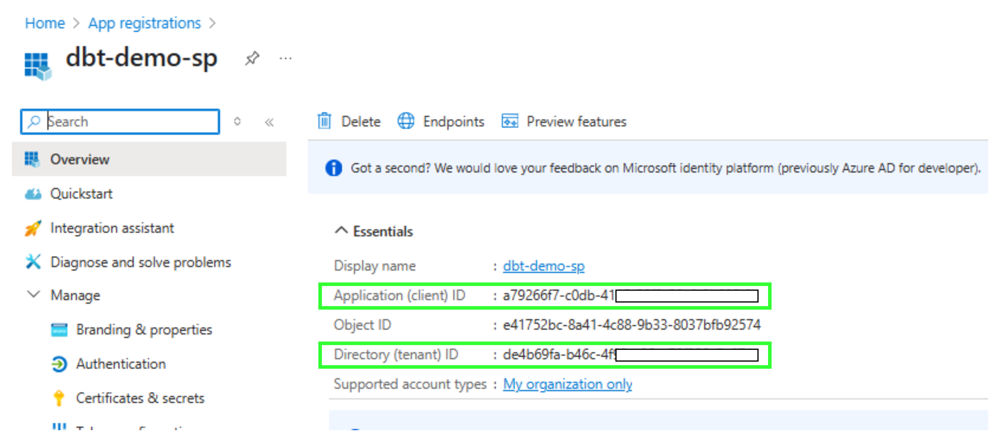

### GitHub Personal Access Token Setup
Part of this process will be accessing your dbt project in its git repository and download to storage.  Within Github, create a Personal Access Token and grant it 'Read-only' access to Contents on your repository, make a note of

* The access token value
* The github organisation where the repository is located
* The name of the github repository
* The username used to access the repository

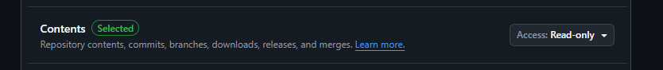

### Microsoft Fabric Setup
* Create a Workspace
* Grant your service principal **Contributor** access to the Workspace.

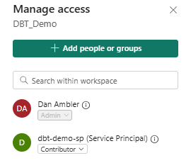

* Create a Lakehouse named **lh_dbt_project**.
* Create a Warehouse named **wh_gold**.
* Make a note of the SQL Endpoint of the Warehouse.
    * To find this select the Warehouse item settings.

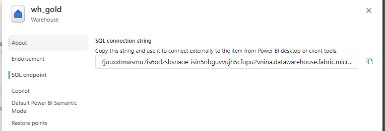

* Create a notebook **nb_populate_warehouse** using the template [here](../fabric/Notebooks/nb_populate_warehouse.ipynb)

* Run the notebook to download some dummy data relating to NYC Taxi Journeys into your Warehouse.  This will provide our source data for the dbt project.

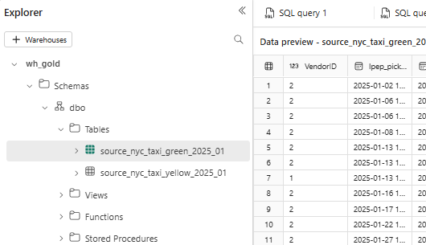

### Azure KeyVault Setup
Create an Azure KeyVault and create these secrets using the values noted from the steps above.  For this demo, 

|Secret name|Value|
|--|--|
|fabric-sp-tenant-id|Value from Service Principal Setup|
|fabric-sp-client-id|Value from Service Principal Setup|
|fabric-sp-client-secret|Value from Service Principal Setup|
|fabric-wh-sql-server|Value from Microsoft Fabric Setup|
|github-repository-name|Value from Github Personal Access Token Setup|
|github-organisation-name|Value from Github Personal Access Token Setup|
|github-user-name|Value from Github Personal Access Token Setup|
|github-access-token|Value from Github Personal Access Token Setup|

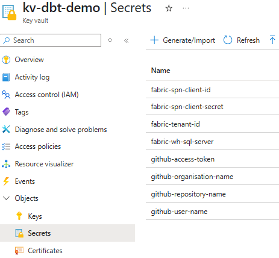

### Spark Environment Setup
The next step is to configure an environment in which dbt will run.  This is your opportunity to add any additional packages you may need.

* Create an environment named **env_dbt_demo**.
* In the **Public Library** section, add these public packages from PyPI.

|Package|Version|
|--|--|
|dbt-core|1.9.4|
|dbt-fabric|1.9.5|

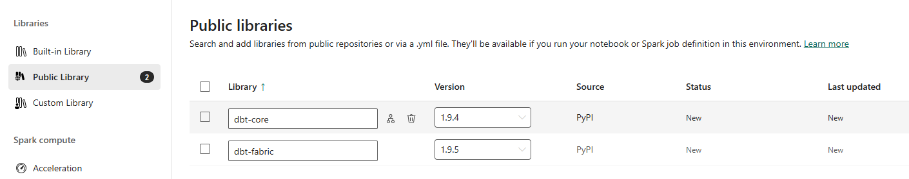

**N.B.** Adding only dbt-fabric would work as dbt-core will be downloaded as part of that package but being explicit here will ensure consistency in your environment.

* Save and Publish your environment changes.  (This can take some time.)

---

## Putting It All Together
Once all prerequisites are setup, we can then create a notebook to execute our dbt project.

* Create a new Notebook named **nb_dbt_demo** using the template [here](../fabric/Notebooks/nb_dbt_demo.ipynb)
* Set the environment for the Notebook to the **env_dbt_demo** you created previously.

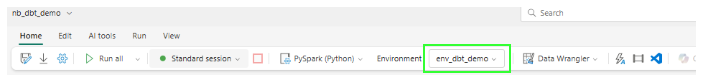

* Add the Lakehouse **lh_dbt_project** created previously and ensure it is set as the default Lakehouse.

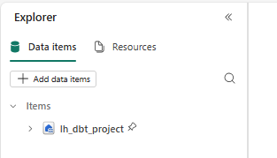

* Run the notebook.

---

## The Results - DBT Run
We can see the dbt project is cloned into Lakehouse storage

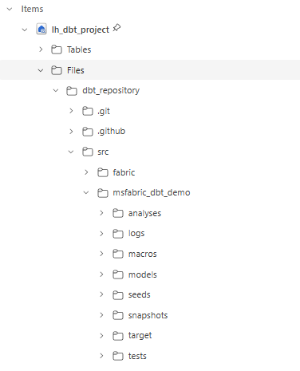

Executing the dbt run command creats our model within the warehouse, materialised as views

### 'dbt run' Output
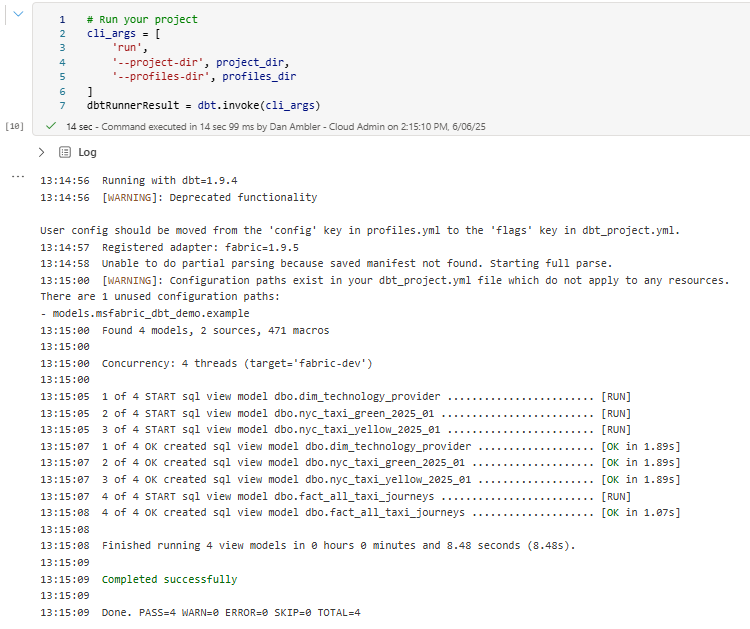

### dbt Models Created
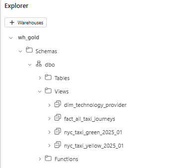

## The Results - Generating Documentation
Executing the dbt docs command has generated a static HTML page containing the documentation and DAG for our model.

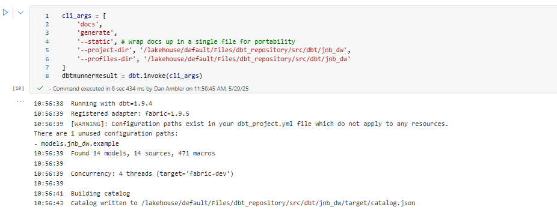
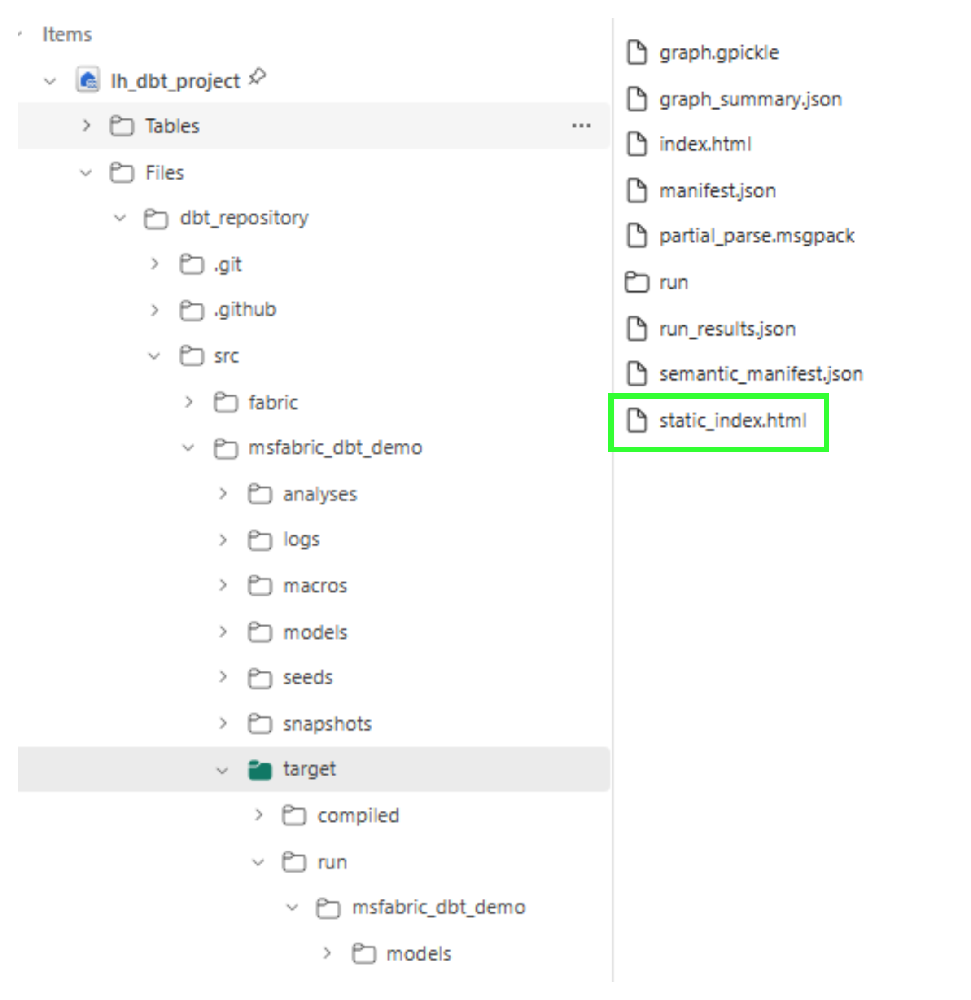

### Documentation Example - Page
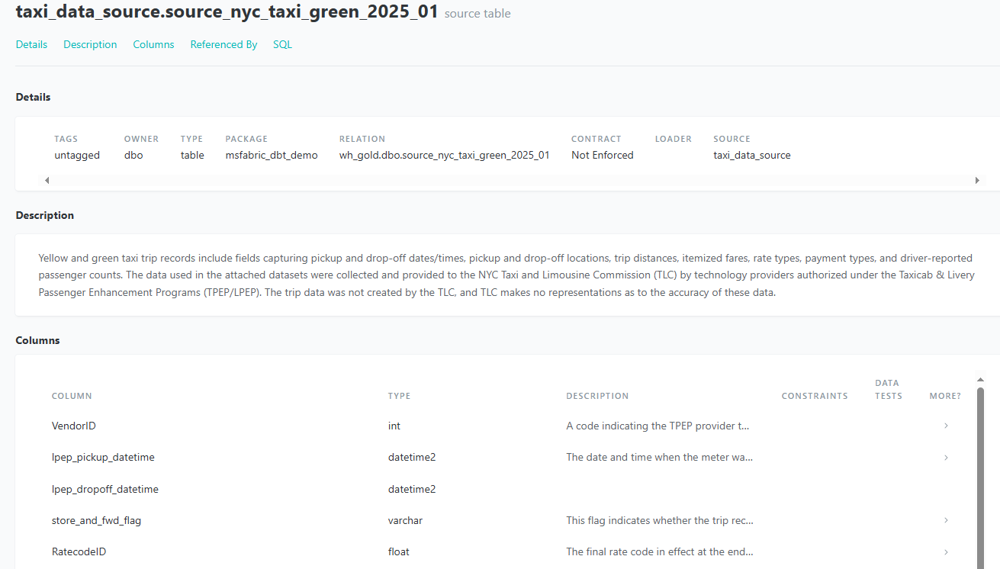

### Documentaiton Example - DAG
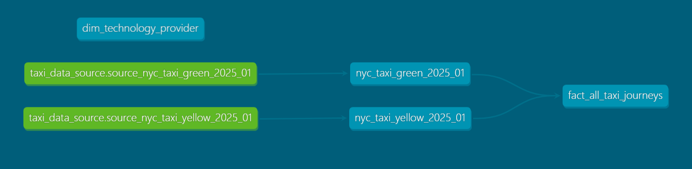